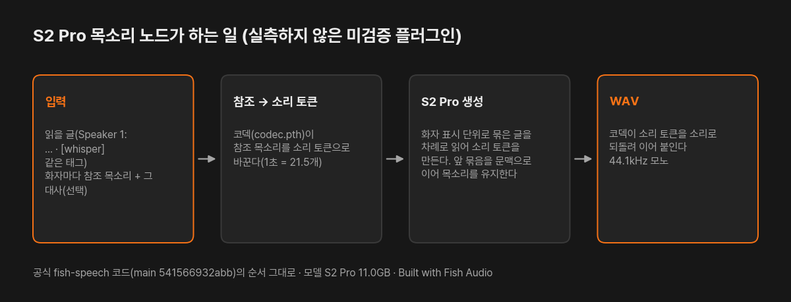
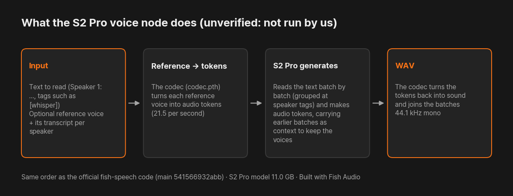

# S2 Pro 목소리 — Fish Audio 모델 · 감정 태그 · 복제 (PromBoard 플러그인)

[English](#english)

글을 읽어 목소리(WAV)를 만드는 PromBoard 커뮤니티 플러그인입니다. Fish Audio 의 오픈 모델 [S2 Pro](https://huggingface.co/fishaudio/s2-pro)를 공식 [fish-speech](https://github.com/fishaudio/fish-speech) 코드로 이 PC 에서 돌립니다. 글 안에 `[whisper]` · `[laughing]` · `[excited]` 같은 자유 태그로 감정 · 말투를 바꾸고, 화자마다 참조 목소리와 그 대사를 이으면 그 목소리로 읽습니다(화자 최대 4명). **실측하지 않은 미검증 플러그인입니다** — 받아 돌려 보지 않았고, 아래 그래픽카드 메모리는 계산값입니다. 모델은 비상업 · 연구 전용입니다.

**Built with Fish Audio.** Fish Audio 가 만들거나 보증한 플러그인이 아닙니다.



실측 결과가 아니라 노드가 하는 일을 그린 그림입니다.

- 플러그인 id: `promboard.fish-s2-pro`
- 필요한 앱: PromBoard 1.0.3 이상
- 지원 언어: 모델 카드 목록 83개(한국어 포함). 카드는 일본어 · 영어 · 중국어를 1등급, 한국어 · 스페인어 · 포르투갈어 · 아랍어 · 러시아어 · 프랑스어 · 독일어를 2등급으로 적습니다.
- 지원 OS: 윈도우 · 리눅스 · 맥(잠금 파일 세 벌이 휠만으로 풀리는 것까지 확인, 실행은 미검증)

## 받는 것과 용량

| 무엇 | 어디서 | 크기 | 라이선스 |
|---|---|---|---|
| S2 Pro 가중치 · 코덱 · 토크나이저 | [fishaudio/s2-pro](https://huggingface.co/fishaudio/s2-pro) (커밋 1de9996 고정, sha256 고정) | 11.0GB | Fish Audio Research License(비상업 · 연구) |
| 파이썬 패키지(PyTorch 2.8 · transformers 5.19 등) | PyPI · PyTorch | 약 3GB(다른 플러그인과 같은 PyTorch 는 다시 받지 않습니다) | 각 패키지 |

## 필요한 그래픽카드 메모리

계산값(실측 아님): 가중치 bf16 약 8.5GB + 코덱 약 0.9GB + 문맥 캐시(문맥 8,192 기준 약 1.1GB) ≈ 10.5GB 에 실행 중 여유가 더 듭니다. 매니저에는 12GB 로 적었습니다. 12GB 그래픽카드에서는 빠듯할 수 있으니 메모리가 모자라다고 나오면 '문맥 길이'를 4,096 으로 줄여 주세요. CPU 로는 돌리지 않습니다. 공식 문서에는 필요한 그래픽카드 메모리 수치가 없습니다.

## 쓰는 법

노드 추가 목록에서 「S2 Pro 목소리」를 놓고 글 노드를 '읽을 글'에 이은 뒤 ▷ 를 누릅니다. 한 번에 4,000자까지 받습니다.

- 여러 명이면 줄마다 `Speaker 1: 글` ~ `Speaker 4: 글`(또는 `1: 글`)처럼 적습니다. 공식 표기 `<|speaker:0|>` 를 써도 됩니다. 화자 표시가 없으면 화자 1 이 읽습니다.
- '화자 N 참조 목소리'에 말소리(10~30초가 좋고 60초까지)를, '화자 N 참조 대사'에 그 소리의 대사를 함께 이으면 그 화자를 그 목소리로 읽습니다. 대사 없이 소리만 이으면 오류로 알려 줍니다. 실존 인물의 목소리는 그 사람의 동의 없이 쓰지 않습니다.

| 설정 | 기본값 | 뜻 |
|---|---|---|
| 문맥 길이 | 8,192 | 한 번에 다룰 글 · 참조 · 만든 소리의 총량. 4,096 · 8,192 · 16,384 · 32,768(공식 설정) 중 고릅니다. 길수록 긴 글을 읽지만 메모리를 더 씁니다 |
| 묶음 크기 (바이트) | 200 | 화자 표시 단위로 글을 이 크기 안에서 묶어 차례로 만듭니다(공식 기본값, 공식 범위 100~1000) |
| 묶음당 최대 소리 토큰 | 1024 | 묶음 하나의 소리 상한(약 48초, 공식 SDK 기본값) |
| 다양성 (temperature) · 후보 범위 (top_p) | 0.7 · 0.7 | 공식 SDK 기본값, 공식 범위 0.1~1 |
| 시드 | 42 | 같은 시드 · 같은 입력이면 비슷한 결과 |

## 어떤 코드로 돌리나

공식 fish-speech(main, 커밋 541566932abb)의 `fish_speech` 패키지를 `nodes/fish_speech` 에 담아, 공식 `text2semantic.inference` 의 `init_model` · `load_codec_model` · `generate_long` · `decode_to_audio` 를 공식 서버와 같은 순서로 부릅니다. 샘플링 기본값은 공식 코드(`sampling.py`, 공식 SDK 값)입니다.

PromBoard 는 휠만으로 설치합니다(소스 빌드 없음). 공식 코드가 쓰는 hydra-core · descript-audiotools 는 휠이 없는 패키지(antlr4 · argbind)를 끌고 와서, 아래만 고쳤습니다. 고친 파일마다 머리 주석에 적었고 목록은 `NOTICE.md` 에 있습니다.

- 코덱 설정 파일(`configs/modded_dac_vq.yaml`)을 hydra 대신 `fish_speech/utils/instantiate.py`(PromBoard 가 쓴 작은 파일)로 객체로 만듭니다. 이렇게 만든 코덱의 매개변수 535개 이름 · 모양이 공식 `codec.pth` 와 모두 같음을 확인했습니다(파일을 다 받지 않고 키 목록만 읽어 대조).
- `modded_dac.py` 에서 쓰지 않던 audiotools import 를 지우고, audiotools 의 `BaseModel`(저장 · 불러오기 도우미가 붙은 `nn.Module`) 대신 `nn.Module` 을 씁니다.
- descript-audio-codec 1.0.0 에서 코덱이 쓰는 파일 3개(MIT)를 `nodes/dac` 에 담았습니다.
- API 서버 · 명령줄 전용 파일 4개는 뺐습니다.

## 실측

하지 않았습니다(이 PC 의 그래픽카드 · 시간 한도로 PM 결정에 따라 미검증으로 공개). 확인한 것: 잠금 파일 세 벌(윈도우 · 리눅스 · 맥)이 휠만으로 풀림, 노드 코드 import, 코덱 조립 결과가 공식 `codec.pth` 키 · 모양과 일치, PromBoard 레지스트리 검사 미리 보기 통과. 써 보신 분은 결과를 이슈로 알려 주세요.

## 라이선스와 조건

- 모델 S2 Pro: [Fish Audio Research License](https://huggingface.co/fishaudio/s2-pro/blob/1de9996b6be38b745688de084d87a5633f714e4e/LICENSE.md). 연구 · 비상업 사용만 무료이고, 상업 사용은 Fish Audio 와 따로 계약합니다. 그래서 매니저에 '비상업'으로 표시됩니다.
- 담아 온 fish-speech 코드: Fish Audio Community License v1.0(`LICENSE-fish-audio.md`, 고지 `NOTICE.md`).
- 동의 없이 실존 인물의 목소리를 흉내 내지 않고, 결과물로 다른 음성 모델을 학습 · 증류하지 않습니다.
- 담아 온 descript-audio-codec 파일 3개: MIT(`nodes/dac/LICENSE`). 플러그인 코드(`nodes/main.py` 등): Apache-2.0(`LICENSE`).

## 파일

```
manifest.json                 플러그인 정보 · 노드 정의 · 받을 모델
icon.png
NOTICE.md                     Fish Audio 고지 · 고친 곳 목록
LICENSE                       Apache-2.0(플러그인 코드)
LICENSE-fish-audio.md         Fish Audio Community License v1.0(담아 온 fish-speech 코드)
nodes/main.py                 노드 코드
nodes/fish_speech/            담아 온 공식 fish_speech 패키지(위 두 파일만 고치고 instantiate.py 를 더함)
nodes/dac/                    descript-audio-codec 1.0.0 파일 3개(MIT)
nodes/requirements.in         직접 쓰는 패키지
nodes/requirements-*.txt      운영체제별 해시 잠금 파일(uv pip compile --generate-hashes --only-binary :all:, Python 3.12)
docs/                         이 README 의 그림(ko · en)과 그 스크립트(docs/scripts). 플러그인 zip 에는 넣지 않는다
```

레지스트리에 올리는 zip 은 PromBoard 앱 저장소의 `server/src/tools/packPlugin.ts` 로 만듭니다. `git archive HEAD` 로 꺼낸 폴더를 넘기면 `.gitattributes` 의 `export-ignore` 로 `docs/` 가 빠집니다.

---

## English

**S2 Pro voice — Fish Audio model, emotion tags, cloning** is a PromBoard community plugin that reads text into a voice (WAV) with Fish Audio's open [S2 Pro](https://huggingface.co/fishaudio/s2-pro) model and the official [fish-speech](https://github.com/fishaudio/fish-speech) code, running on this PC. Free-form tags in the text such as `[whisper]`, `[laughing]` or `[excited]` change emotion and delivery, and a reference voice plus its transcript per speaker clones that voice (up to 4 speakers). **This plugin is unverified: we have not downloaded and run it**, and the GPU memory below is a calculation. The model is for non-commercial and research use only.

**Built with Fish Audio.** This plugin is not made or endorsed by Fish Audio.



The picture shows what the node does; it is not a measured result.

- Plugin id: `promboard.fish-s2-pro`
- Requires PromBoard 1.0.3 or later
- Languages: the 83 languages listed on the model card, Korean included. The card lists Japanese, English and Chinese as tier 1, and Korean, Spanish, Portuguese, Arabic, Russian, French and German as tier 2.
- Operating systems: Windows, Linux and macOS (the three lock files resolve from wheels only; running is unverified)

### What it downloads

| What | From | Size | License |
|---|---|---|---|
| S2 Pro weights, codec and tokenizer | [fishaudio/s2-pro](https://huggingface.co/fishaudio/s2-pro) (pinned to commit 1de9996, sha256 pinned) | 11.0 GB | Fish Audio Research License (non-commercial, research) |
| Python packages (PyTorch 2.8, transformers 5.19, …) | PyPI · PyTorch | about 3 GB (PyTorch shared with other plugins is not downloaded again) | per package |

### GPU memory

Calculated, not measured: about 8.5 GB of bf16 weights + about 0.9 GB codec + the context cache (about 1.1 GB at a context length of 8,192) ≈ 10.5 GB, plus working memory. The manager lists 12 GB. A 12 GB GPU may be tight; if you run out of memory, lower **문맥 길이** (context length) to 4,096. CPU is not enabled. The official documents give no GPU memory figure.

### Use

Add the **S2 Pro 목소리** node, connect a text node to **읽을 글** (text to read) and press ▷. Up to 4,000 characters per run.

- For several speakers, start each line with `Speaker 1: text` to `Speaker 4: text` (or `1: text`); the official `<|speaker:0|>` tags also work. Without speaker marks, speaker 1 reads everything.
- Connect speech (10–30 s is best, up to 60 s) to **화자 N 참조 목소리** (speaker N reference voice) and its transcript to **화자 N 참조 대사** (speaker N reference transcript) to read that speaker in that voice. A reference voice without its transcript is reported as an error. Do not use a real person's voice without their consent.
- Settings (labels inside the app are in Korean): **문맥 길이** context length (default 8,192; 4,096 / 8,192 / 16,384 / 32,768 = official), **묶음 크기** batch size in bytes (default 200, official range 100–1000), **묶음당 최대 소리 토큰** max audio tokens per batch (default 1024 ≈ 48 s, official SDK default), **다양성 (temperature)** and **후보 범위 (top_p)** (0.7 each, official SDK defaults, range 0.1–1) and **시드** seed.

### Code path

The `fish_speech` package from the official fish-speech repo (main, commit 541566932abb) is bundled in `nodes/fish_speech`, and the node calls the official `text2semantic.inference` functions `init_model`, `load_codec_model`, `generate_long` and `decode_to_audio` in the same order as the official server. Sampling defaults are the official ones (`sampling.py`, the official SDK values).

PromBoard installs from wheels only (no source builds). hydra-core and descript-audiotools, which the official code uses, pull in packages without wheels (antlr4, argbind), so only the following was changed. Each changed file says so in its header, and `NOTICE.md` lists them.

- The codec config (`configs/modded_dac_vq.yaml`) is built by `fish_speech/utils/instantiate.py` (a small file written by PromBoard) instead of hydra. The resulting codec has the same 535 parameter names and shapes as the official `codec.pth` (checked against the key list read from the file without downloading all of it).
- `modded_dac.py` drops an unused audiotools import and uses `nn.Module` instead of audiotools' `BaseModel` (an `nn.Module` with save/load helpers).
- Three files from descript-audio-codec 1.0.0 (MIT) that the codec uses are bundled in `nodes/dac`.
- Four API-server and command-line files are left out.

### Measured

Not run (released as unverified by PM decision because of this PC's GPU and time limits). Checked: the three lock files (Windows, Linux, macOS) resolve from wheels only, the node code imports, the assembled codec matches the official `codec.pth` keys and shapes, and the PromBoard registry check preview passes. If you try it, please report the result in an issue.

### License and conditions

- S2 Pro model: [Fish Audio Research License](https://huggingface.co/fishaudio/s2-pro/blob/1de9996b6be38b745688de084d87a5633f714e4e/LICENSE.md). Research and non-commercial use is free; commercial use needs a separate license from Fish Audio. The manager therefore marks the plugin non-commercial.
- Bundled fish-speech code: Fish Audio Community License v1.0 (`LICENSE-fish-audio.md`, notice in `NOTICE.md`).
- Do not imitate a real person's voice without consent, and do not use the outputs to train or distill other speech models.
- Bundled descript-audio-codec files: MIT (`nodes/dac/LICENSE`). Plugin code (`nodes/main.py` and the rest): Apache-2.0 (`LICENSE`).

The `docs/` folder holds the pictures for this README and their script, and is left out of the plugin zip (`git archive HEAD` + `export-ignore`).
